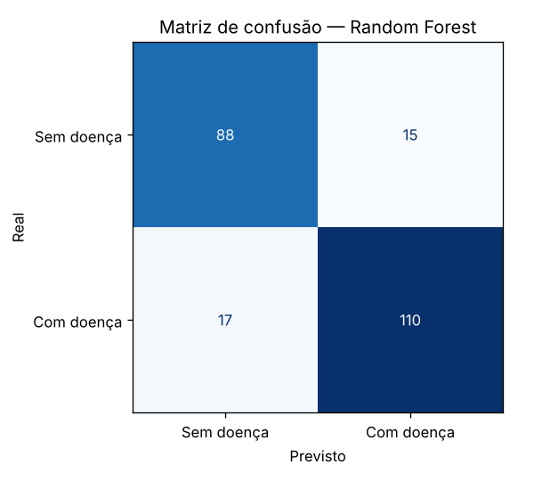
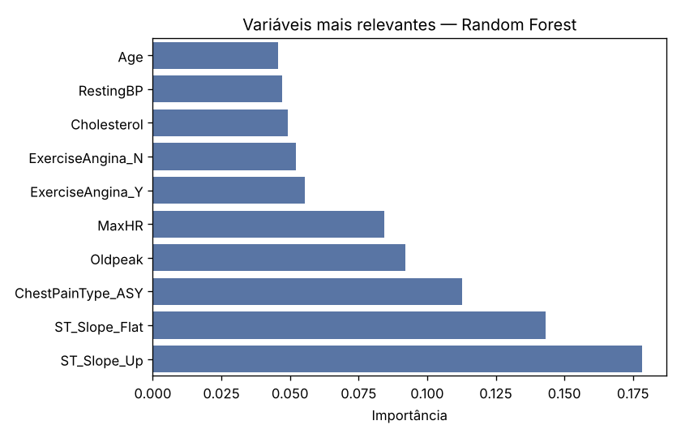

# Classificação de Risco de Doença Cardíaca

Modelo de Machine Learning que estima se um paciente tem doença cardíaca a partir de 11 atributos clínicos (idade, sexo, tipo de dor no peito, pressão, colesterol, frequência cardíaca máxima, ECG etc.).

Como é um problema de **triagem**, a métrica priorizada é o **recall da classe positiva**: deixar passar um paciente doente é o erro mais caro.

## Resultados

Conjunto de teste com 230 pacientes (25%, estratificado), mais validação cruzada de 5 folds no treino.

| Métrica | Regressão Logística | **Random Forest** |
|---|---|---|
| Recall (com doença) — teste | 0,819 | **0,866** |
| ROC AUC — teste | 0,926 | **0,937** |
| Acurácia — teste | 0,839 | **0,861** |
| ROC AUC — validação cruzada | 0,919 ± 0,019 | 0,924 ± 0,018 |

<p float="left">
  
  
</p>

**Leitura dos resultados**

- O Random Forest identifica **~87% dos pacientes doentes** no teste. A Regressão Logística fica perto, o que mostra que um modelo simples e interpretável já captura boa parte do sinal.
- As variáveis mais relevantes são a inclinação do segmento ST (`ST_Slope`), dor no peito assintomática (`ChestPainType_ASY`), depressão do ST (`Oldpeak`) e frequência cardíaca máxima, coerentes com a literatura clínica.

## Tratamento dos dados

- **Valores impossíveis:** 172 registros tinham colesterol = 0 (e 1 com pressão = 0). Eles foram tratados como **dados ausentes** e imputados pela mediana, em vez de entrarem no modelo como zero.
- **Variáveis categóricas:** One-Hot Encoding, para não criar uma ordem artificial entre categorias.
- **Pipeline do scikit-learn:** a imputação e a padronização são ajustadas só no treino, evitando vazamento de dados para o teste.

## Como executar

```bash
pip install -r requirements.txt
python heart_failure_predictor.py
```

O script imprime as métricas e salva os gráficos em `images/`.

## Dados

[Heart Failure Prediction Dataset — Kaggle](https://www.kaggle.com/datasets/fedesoriano/heart-failure-prediction): 918 pacientes, 11 atributos, 55% com doença cardíaca.

## Próximos passos

- Ajustar o limiar de decisão para priorizar recall (ex.: recall ≥ 0,95) e medir o custo em falsos positivos
- Testar Gradient Boosting (XGBoost/LightGBM)
- Explicar previsões individuais com SHAP

> Projeto de estudo. Não deve ser usado para diagnóstico.

## Tecnologias

Python · pandas · scikit-learn · Matplotlib · seaborn
